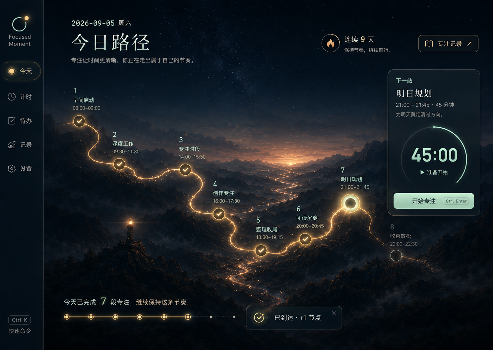
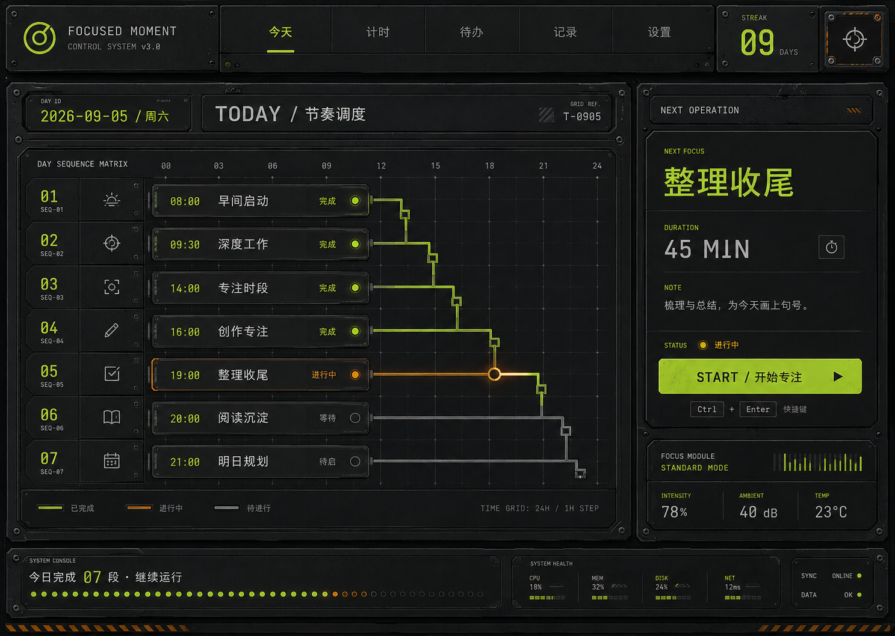
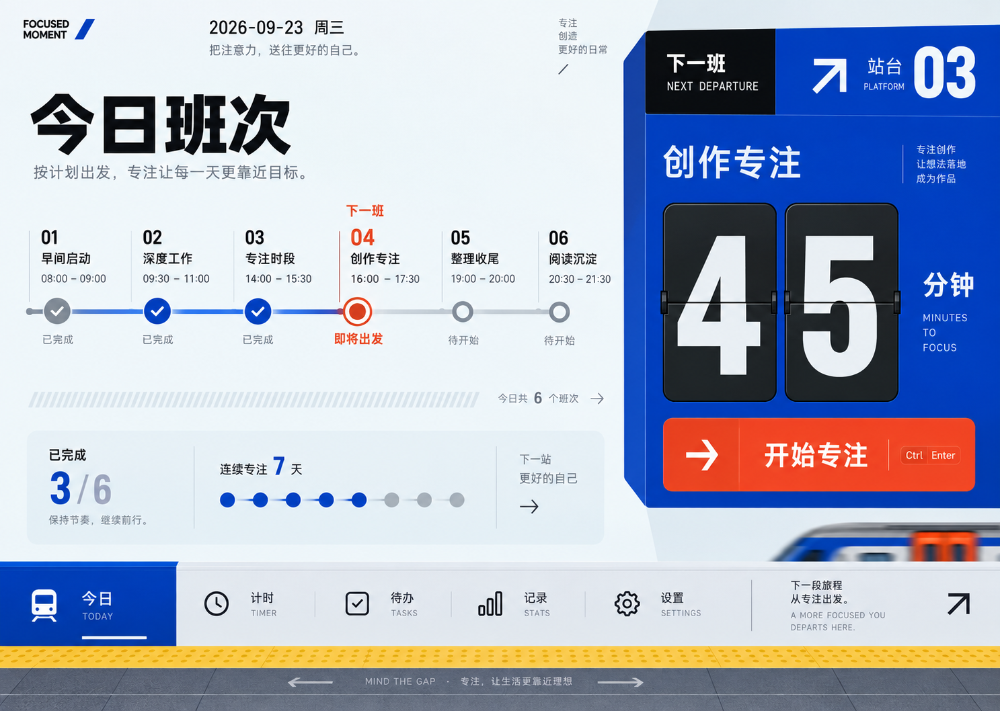

# Focused Moment

> 一个把待办、计时和专注记录放在一起的本地桌面工具。

[](https://github.com/zhulongqihan/Focused-Moment/releases/latest)
[](https://github.com/zhulongqihan/Focused-Moment/actions/workflows/ci.yml)
[](https://github.com/zhulongqihan/Focused-Moment/releases/latest)
[](./LICENSE)

Focused Moment 适合不想用复杂项目管理系统、但又想把事情做完并留下记录的人。写下下一件待办，开始一段专注，做完之后回头看看自己的投入；数据默认留在本机，不需要注册账号。

## 预览

五套常用主题使用同一套待办、计时、记录和本地数据，只改变呈现方式。你可以根据当天的工作状态选择更安静、清晰或沉浸的界面。

<table>
  <tr>
    <td width="50%"></td>
    <td width="50%"></td>
  </tr>
  <tr>
    <td align="center">夜谷 · Night Valley</td>
    <td align="center">编辑纸页 · Editorial Paper</td>
  </tr>
  <tr>
    <td width="50%"></td>
    <td width="50%"></td>
  </tr>
  <tr>
    <td align="center">石墨控制台 · Graphite Console</td>
    <td align="center">今日班次 · Metro Pulse</td>
  </tr>
  <tr>
    <td width="50%"></td>
    <td></td>
  </tr>
  <tr>
    <td align="center">今日赛场 · Clutch Court</td>
    <td></td>
  </tr>
</table>

## 核心功能

| 模块 | 能做什么 |
| --- | --- |
| **今日** | 选定当前事项和最多 3 个今日精选，直接开始、暂停、继续或完成专注；查看当天投入和最近进展。每日一句从本地语料库按日期稳定选择。 |
| **待办** | 快速记下未安排事项，再补日期、时间和重要程度；支持编辑、完成、撤销、删除和直接带入专注。保存停笔书签，下次继续时找到上次的位置。 |
| **计时** | 在正向计时和倒计时之间切换；倒计时支持 1–720 分钟。可以开始、暂停、继续、重置，并在完成后保存专注记录。 |
| **专注记录** | 按日期回看投入和最近节奏；支持手动补录，以及标题、时长、完成时间和关联待办的修正。 |
| **悬浮工作台** | 将待办或当前计时放到桌面置顶窗口；支持拖动、待办/计时切换、透明度调节、锁定与鼠标穿透，专注时可以隐藏主窗口。 |
| **提醒与声音** | 支持应用内弹窗、任务栏提醒、多个内置提示音和自定义音效导入；提醒行为与声音设置会保存在本机。 |
| **Windows 托盘** | 从通知区域查看当前计时和事项，暂停/继续计时，打开悬浮工作台，或直接跳转到今日、计时、待办和记录。 |
| **本地优先** | 待办、记录、未完成计时状态、设置和备份都保存在本机；支持导出、导入和旧格式迁移。 |

## 五套常用主题

- **夜谷 · Night Valley**：深夜山谷、金色路径与薄荷色状态。
- **编辑纸页 · Editorial Paper**：纸张、铅字与可读性的工作界面。
- **石墨控制台 · Graphite Console**：铆钉、信号灯与可执行序列的深色控制台。
- **今日班次 · Metro Pulse**：蓝白交通导视、清晰站台与准点出发。
- **今日赛场 · Clutch Court**：篮球场、战术回合与关键时刻。

设置页的“旧版主题”区域还保留 **极光海面 · Aurora Ocean** 和 **植物书房 · Botanical Library**，可按需切换；它们不计入常用五套主题。

## 下载

[Windows v2.14.2](https://github.com/zhulongqihan/Focused-Moment/releases/tag/v2.14.2) 提供以下 x64 资产。升级内容见[版本说明](./docs/v2.14.2/RELEASE_NOTES.md)。

| 文件 | 建议 |
| --- | --- |
| [Setup 安装版](https://github.com/zhulongqihan/Focused-Moment/releases/download/v2.14.2/Focused.Moment.Setup.v2.14.2.exe) | 推荐大多数用户使用的标准安装程序。 |
| [便携版 EXE](https://github.com/zhulongqihan/Focused-Moment/releases/download/v2.14.2/Focused.Moment.v2.14.2.exe) | 下载后可直接运行，不需要安装。 |
| [MSI 安装包](https://github.com/zhulongqihan/Focused-Moment/releases/download/v2.14.2/Focused.Moment_2.14.2_x64_en-US.msi) | 适合企业部署或习惯使用 Windows Installer 的用户。 |

安装包已经包含前端资源和 Rust 核心。普通用户不需要安装 Node.js、Rust、pnpm 或下载源码。

### 本地 Windows 入口与来源

本机工作区根目录的 `Focused Moment.exe` 为 **2.14.2**，与本版本便携资产使用同一份程序。

| 项目 | 当前值 |
| --- | --- |
| Build ID | `local-20261023-170710-9bdc15b316` |
| 构建时源码基点 | `a236df56f653d3abb9b0c65900f61faa43a90332`，含 manifest 记录的工作区修复 |
| SHA-256 | `9299A959D72C8CF81B5B751D1A61149A681E8C022E761F889574AA1B0A9BCCFA` |
| 本机 provenance | `artifacts/builds/local/local-20261023-170710-9bdc15b316/manifest.json` |

候选、根入口与便携资产具有相同 SHA-256；本机 Release 交付记录了旧入口恢复副本和构建输入指纹。最终源提交与包内容核对见[发布验收记录](./docs/maintenance/release-readiness-2.14.2.md)。

当前 macOS 官方发布暂时冻结；源码仍保留跨平台构建配置。需要 macOS 资产时，可以查看此前最后一个包含 Universal DMG 的 [v2.10.11 Release](https://github.com/zhulongqihan/Focused-Moment/releases/tag/v2.10.11)，或按照下方说明在 macOS 上从源码构建。

如果 Windows SmartScreen 提示文件未签名，请先确认文件来自本仓库的 [Release 页面](https://github.com/zhulongqihan/Focused-Moment/releases)，再按系统提示继续。

## 快速开始

1. 快速记下要做的事，不填日期的事项会进入收件箱；选定当前事项或加入今日精选。
2. 在“今日”开始专注；需要选择正向计时或倒计时时，打开“计时”设置。
3. 需要停下时选择“暂停”，准备好后继续；需要桌面陪伴时打开“悬浮工作台”。
4. 点击“完成并记录”保存本轮投入。待办会保留，直到你主动标记完成。
5. 可保存停笔书签，下次继续时找到上次的位置；也可以跳过书签直接结束。

## 数据、备份与隐私

Focused Moment 当前没有账号体系和云同步，核心数据只保存在本机，也不会自动上传待办、记录或备份。

默认数据目录：

- Windows：`%LOCALAPPDATA%\\FocusedMoment`
- macOS：`~/Library/Application Support/FocusedMoment`

应用内备份建议这样使用：

1. 在“设置”的“完整备份与恢复”中选择导出位置，再导出 JSON。
2. 将备份复制到安全位置或新电脑，并保留原始数据。
3. 选择 JSON 文件并预览，核对内容后确认导入；需要恢复主题和自定义音效时，勾选对应选项。

导入会替换当前数据，并先生成回滚备份。当前格式为 v3，支持旧格式迁移；升级前保留旧版备份，便于回退。详细范围、限制与操作见[数据备份与换机](./docs/data-portability.md)。

## 从源码运行

### 环境要求

- Windows x64 或 macOS
- Node.js 22+
- pnpm 10+
- Rust stable toolchain
- Windows 上需要 WebView2 Runtime

### 安装与开发

```bash
cd app
pnpm install --frozen-lockfile
pnpm tauri dev
```

如果只需要在浏览器中预览前端界面，可以运行：

```bash
cd app
pnpm dev
```

### 检查与测试

```bash
cd app
pnpm check
pnpm verify
pnpm build
pnpm test:frontend
pnpm test:native-contracts
cargo fmt --check --manifest-path src-tauri/Cargo.toml
cargo check --locked --manifest-path src-tauri/Cargo.toml
cargo test --locked --manifest-path src-tauri/Cargo.toml
```

`pnpm verify` 是不启动应用的快速治理入口：它会检查前端/原生边界、CSS 顺序、Tauri 命令契约、交付脚本 fixture、TypeScript 和 Rust；它不会构建、制作安装包或发布。Windows 隔离原生验证使用 `pnpm native:windows`，前端流程测试使用 Playwright，覆盖今日、待办、计时、记录、设置、悬浮工作台和五套主题的主要交互。

交付根目录便携入口时使用：

```bash
cd app
pnpm package:local
```

该命令只执行真实 `tauri build --no-bundle`，验收精确的 `app/src-tauri/target/release/focused-moment.exe`，再安全更新根目录 `Focused Moment.exe`，并将输入指纹、源码 HEAD、候选与最终 SHA-256 和恢复信息写入 `artifacts/builds/local/<build-id>/`，旧入口恢复副本写入 `archive/executables/local/<build-id>/`。它不会创建 tag、发布 GitHub Release 或上传资产。

### 构建 Windows 安装包

在 Windows 上运行：

```bash
cd app
pnpm package:local
pnpm tauri bundle --bundles "nsis,msi" --ci
```

第二条命令将刚构建的 Release 程序封装为安装包。当前版本的确定输出为 `app/src-tauri/target/release/bundle/nsis/Focused Moment_2.14.2_x64-setup.exe` 和 `app/src-tauri/target/release/bundle/msi/Focused Moment_2.14.2_x64_en-US.msi`。发布前核对版本、源提交和 SHA-256，并将三项资产保存到独立目录；安装包生成不会自动发布。

### 构建 macOS Universal 包

在 macOS 上运行：

```bash
cd app
pnpm install --frozen-lockfile
rustup target add aarch64-apple-darwin x86_64-apple-darwin
pnpm tauri build --target universal-apple-darwin
```

macOS 发布工作流目前保持手动冻结，不代表共享源码中的 macOS 构建配置已移除。

## 项目结构

```text
Focused Moment.exe           根目录唯一固定的直接测试入口
app/                         完整应用工程、依赖、缓存、测试和工具
app/src/                     SolidJS 应用壳层与主题页面
app/src/features/            Shell 控制器、待办/记录/共享派生逻辑
app/src/lib/                 类型契约、待办/计时/窗口调用封装
app/src/styles/              保持原级联顺序的分段 CSS 入口
app/public/theme-previews/   五套主题预览图
app/src-tauri/src/           Rust 计时、命令、桌面、存储与运行入口
app/tests/                   Playwright 前端流程测试
app/scripts/                 构建、交付、契约、结构、性能与发布脚本
docs/                        正式产品、开发、架构、计划和提示词
artifacts/                   当前构建、测试证据、日志和 provenance
archive/                     已核实旧程序、旧报告和恢复副本
local/                       明确属于本机的私有工作资料
```

更完整的职责边界、数据路径和验证分类见 [`docs/architecture.md`](./docs/architecture.md)；源码重构记录见 [`docs/maintenance/structure-refactor.md`](./docs/maintenance/structure-refactor.md)，本轮外层迁移、提交、证据和保护结果见 [`docs/maintenance/workspace-migration.md`](./docs/maintenance/workspace-migration.md)。

## 反馈与贡献

遇到安装、数据迁移、计时或窗口问题，欢迎在 [Issues](https://github.com/zhulongqihan/Focused-Moment/issues) 中提供：

- 操作系统与 Focused Moment 版本；
- 安装版还是便携版；
- 可复现步骤，以及问题出现在哪个页面或窗口；
- 必要时附上不含个人隐私的截图或日志。

提交代码前请先运行上面的检查与测试，并在 Pull Request 中说明变更范围和验证结果。

## 许可

本项目使用 [MIT License](./LICENSE)。每日一句语料条目的来源与许可信息见 [`app/src/data/copy-library.json`](./app/src/data/copy-library.json) 和 [`docs/content/copy-library-sources.md`](./docs/content/copy-library-sources.md)。
